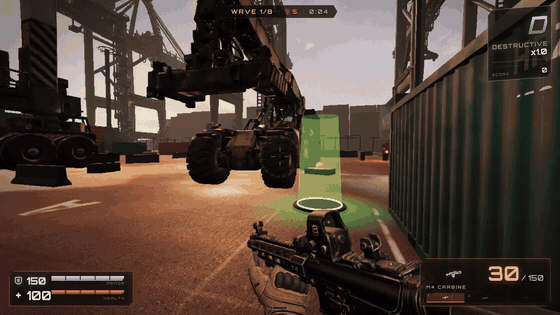
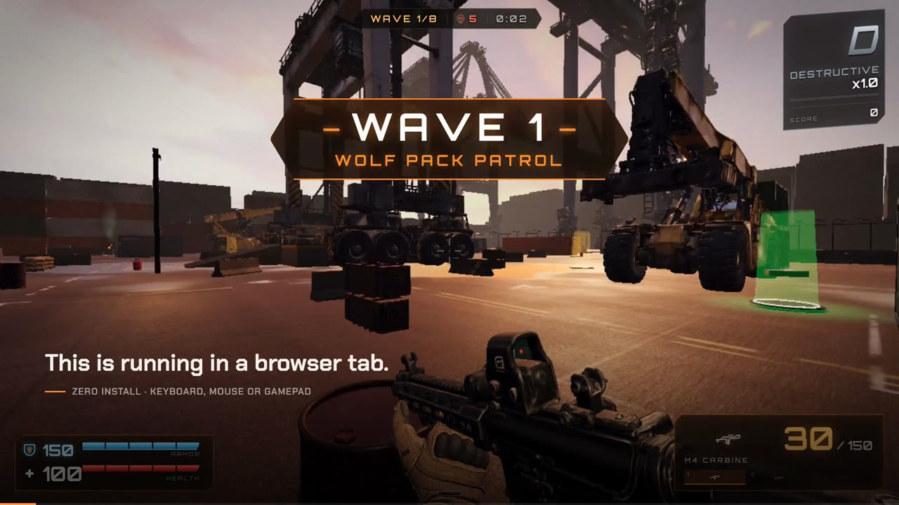
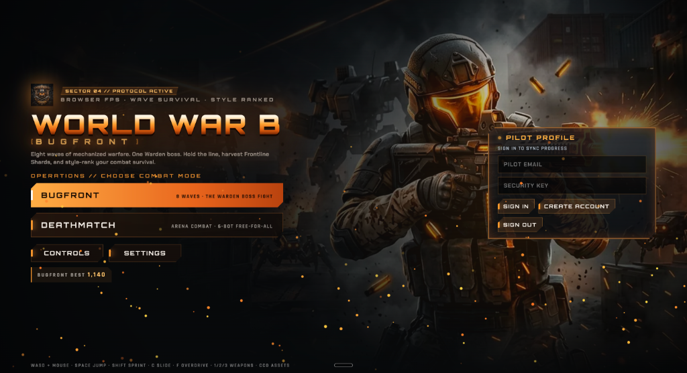
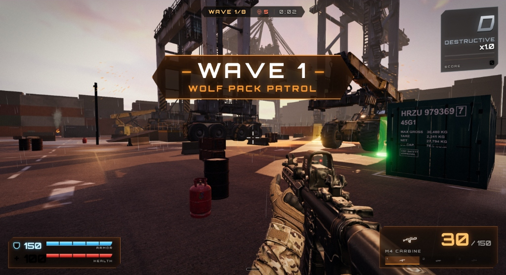
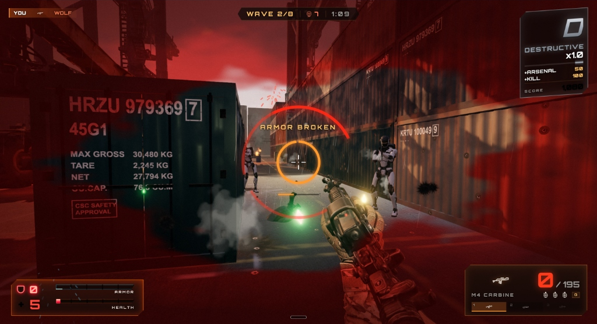
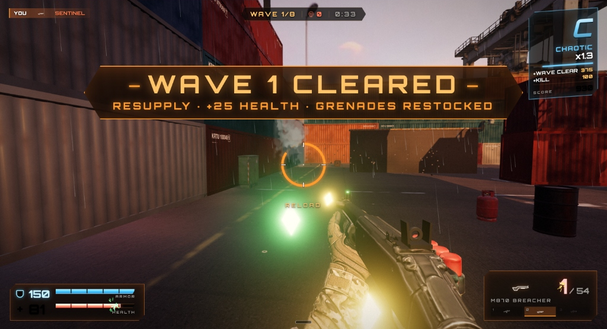
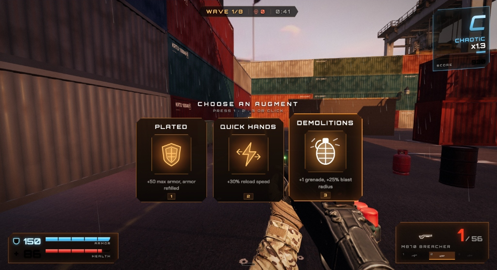

<div align="center">

# World War B: Bugfront
### *A 3D browser FPS built with TypeScript, Three.js, Rapier WASM physics, and Supabase Realtime*

[](https://jeevesh2515.github.io/WWB/)
[](https://github.com/jeevesh2515/WWB)
[](https://github.com/jeevesh2515/WWB/actions)
[](https://www.typescriptlang.org/)
[](https://threejs.org/)
[](https://rapier.rs/)
[](https://supabase.com/)
[](LICENSE)

<br/>

### [**▶ Play in your browser (no install)**](https://jeevesh2515.github.io/WWB/)

*Runs in a modern desktop browser with keyboard/mouse or a standard gamepad. Performance varies by device and scene.*

<br/>

<a href="https://jeevesh2515.github.io/WWB/">
  
</a>

<a href="https://jeevesh2515.github.io/WWB/">
  
</a>

<br/>

▶ **[Play Live in Browser](https://jeevesh2515.github.io/WWB/)** &nbsp;•&nbsp; **[Download 35s Trailer (MP4, 3.8 MB)](https://github.com/jeevesh2515/WWB/raw/main/docs/media/wwb_trailer.mp4)**

*In-game footage: Three.js WebGL rendering with Rapier WASM physics.*

</div>

## Engineering summary

World War B: Bugfront is a no-install 3D browser game I built to explore real-time simulation, WebAssembly physics, client-side performance, and resilient multiplayer state.

I designed and implemented the TypeScript game loop, the fixed-step Rapier physics bridge, combat and wave rules, enemy AI, staged asset streaming, Supabase profile/save integration, the duel lobby, score synchronisation, CPU fallback, and the automated verification scripts.

**What's in the codebase:**

- Three.js WebGL rendering with Rapier 3D WASM physics
- Offline-first gameplay with optional Supabase cloud sync
- Supabase Realtime lobby and score broadcast for 1v1 bot races
- 60 Hz fixed-step simulation; game-rule modules free of rendering code, tested with Vitest
- Playwright multi-window duel verification and a headless smoke test
- GitHub Actions build (typecheck, Vite bundle, size budget) and deploy to GitHub Pages

> **Scope note:** Duel mode synchronizes lobby and score state for a 1v1 bot race; it is not authoritative player-versus-player netcode.

---

## Screenshots

<div align="center">

### Landing page and 1v1 bot-race lobby
*Main menu, pilot profile panel, and the duel staging lobby with room code and copy buttons.*


<br/><br/>

### Wave 1 — Kestrel Terminal port deck
*Container yard with PBR materials, wet concrete, rain, and scanned RTG cranes.*


<br/><br/>

### Close-quarters combat at low health
*Armor-broken warning and low-health vignette while fighting Sentinel droids.*


<br/><br/>

### Wave cleared and shard pickups
*Defeated bots drop health, armor, and ammo shards.*


<br/><br/>

### Augment selection between waves
*Stackable perk cards rendered with an inline SVG icon set.*


</div>

---

## Technical challenges

1. **Stable simulation:** gameplay and physics advance in fixed 1/60 s steps through an accumulator loop (`src/engine/loop.ts`); rendering interpolates between the last two states, and frame time is clamped to avoid a catch-up spiral after a stall.
2. **Fast first interaction:** assets load in stages (`src/game/stages.ts`); the title and first wave wait only for stage 1, and later stages stream in the background.
3. **Resilient duel state:** room membership uses Realtime presence; each client owns its own kill count and periodically broadcasts its total so the rival's counter resyncs if kill events are lost. A CPU rival takes over when the peer disconnects or the network is unavailable.
4. **Browser-safe backend access:** the client ships only the public Supabase URL and anon key; row-level security restricts each table to the signed-in user's rows.
5. **Testable game logic:** match rules, the wave director/style meter, the save store, and the duel wire protocol live in modules that do not import Three.js, so they run under Vitest without a WebGL canvas.

## Project status

- **Status:** Public portfolio release, active iteration
- **Live build:** [GitHub Pages](https://jeevesh2515.github.io/WWB/)
- **Primary branch:** `main`
- **Known limitation:** Duel mode synchronizes lobby and score state; it is not authoritative player-versus-player netcode.

## Key architecture decisions

- **Why Rapier WASM:** fast 3D collision and rigid-body simulation in the browser, stepped at the loop's fixed rate.
- **Why pure rule modules:** combat, waves, scoring, and duel-wire logic can be tested without a WebGL canvas.
- **Why offline-first:** the game is fully playable without an account or network; cloud features add progression sync rather than gate play.

## About the game

**World War B: Bugfront** is a first-person shooter built on web technologies (**Three.js WebGL + Rapier3D WebAssembly**).

You play **Kai**, holding a storm-lit container port (**Kestrel Terminal**) through **8 waves** of mercenaries, combat droids, hounds, and exoskeletons, ending in a boss fight against **The Warden**.

### Core mechanics

- **Shard pickups:** defeated bots drop health, armor, and ammo shards, which rewards pushing forward over camping.
- **Style ranks:** kills, headshots, slide kills, airborne kills, multi-kills, and explosive kills fill a style meter with ranks `D → C → B → A → S → SS → FRONTBREAKER`. Rank multiplies score (1× up to 4×); taking a hit drops a rank.
- **Augment perks:** between waves, pick one of eight stackable perks:
  - **Hollow Points:** +20% rifle damage
  - **Quick Hands:** +30% reload speed
  - **Plated:** +50 max armor, armor refilled
  - **Scavenger:** +50% shard magnet radius, +25% shard value
  - **Overclock:** +35% Overdrive charge rate
  - **Demolitions:** +1 grenade, +25% blast radius
  - **Vampire Core:** every kill restores 5 health
  - **Choke:** -30% shotgun spread, +15% damage
- **Overdrive:** a full style meter enables a 7-second Overdrive with 1.5× damage, 1.3× fire rate, and infinite ammo.
- **Game modes:**
  - **Bugfront (Onslaught):** 8 escalating waves ending in the Warden boss encounter.
  - **Deathmatch:** bot arena; first to 20 frags wins.
  - **Duel (1v1 bot race):** you and one rival hunt the same bot pack for 3 minutes; no PvP, most bot kills wins.
    - **Staging lobby:** `HOST · GET CODE` creates a 6-character room code; `COPY CODE` / `COPY INVITE LINK` copy it to the clipboard.
    - **Peer discovery:** when a friend joins with the code, the host's lobby shows `RIVAL JOINED` and enables `START MATCH`.
    - **Host-controlled start:** the host starts the match and both clients enter a shared 3-second countdown.
    - **Score sync:** each client is authoritative for its own kills and broadcasts kill events over Supabase Realtime; periodic state packets carry kill totals to repair lost events.
    - **CPU fallback:** start solo with `START NOW (VS CPU)`, or let a CPU rival take over if the peer disconnects mid-match.
- **Title backdrop:** the arena behind the menu runs bots against bots; your match starts after you pick a mode.

---

## Controls

| Action | Keyboard & Mouse | Gamepad (Standard) |
| :--- | :--- | :--- |
| **Look** | Mouse (click to capture pointer lock) | Right Stick |
| **Move** | <kbd>W</kbd> <kbd>A</kbd> <kbd>S</kbd> <kbd>D</kbd> / Arrows | Left Stick |
| **Sprint** | <kbd>Shift</kbd> | <kbd>L3</kbd> (Left stick click) |
| **Jump** | <kbd>Space</kbd> | <kbd>A</kbd> / <kbd>✕</kbd> |
| **Crouch & Slide** | <kbd>C</kbd> or <kbd>Left Ctrl</kbd> (tap while sprinting to slide) | <kbd>B</kbd> / <kbd>R3</kbd> |
| **Fire** | Left Mouse Button | <kbd>RT</kbd> / Right Trigger |
| **Aim Down Sights** | Right Mouse Button | <kbd>LT</kbd> / Left Trigger |
| **Reload** | <kbd>R</kbd> | <kbd>X</kbd> / <kbd>◻</kbd> |
| **Weapon Selection** | <kbd>1</kbd> Rifle · <kbd>2</kbd> Shotgun · <kbd>3</kbd> Rocket · <kbd>Q</kbd> / Wheel Last | <kbd>Y</kbd> / <kbd>RB</kbd> Next · <kbd>LB</kbd> Prev |
| **Frag Grenade** | <kbd>G</kbd> | D-Pad Down |
| **Activate Overdrive**| <kbd>F</kbd> (when charged) | D-Pad Up |
| **Choose Augment** | <kbd>1</kbd> / <kbd>2</kbd> / <kbd>3</kbd> or Click | D-Pad Left / Up / Right |
| **Scoreboard** | Hold <kbd>Tab</kbd> | Select / Back |
| **Pause & Settings** | <kbd>Esc</kbd> / <kbd>P</kbd> | Start |

---

## Technical architecture

```
WWB/
├── src/
│   ├── main.ts              # Bootstrap, mode/state management, duel session wiring
│   ├── engine/              # Fixed-step loop, Rapier physics bridge, renderer, audio, input, save store
│   ├── game/
│   │   ├── game.ts          # Match orchestrator, damage, combat resolution
│   │   ├── rules.ts         # Pure match rules, frag/death tracking, medals, scoring
│   │   ├── onslaught.ts     # Pure wave plans, style meter, perk effects
│   │   ├── weapons.ts       # Weapon mechanics, recoil, hitscan and projectiles
│   │   ├── bots.ts          # Enemy AI navigation, combat routines, rival puppet driver
│   │   ├── stages.ts        # Staged asset loader with background streaming
│   │   └── arena.ts         # Procedural shipping containers and Kestrel port deck
│   ├── net/
│   │   ├── duel.ts          # Pure duel protocol: room codes, wire validation, rival interpolation
│   │   └── lobby.ts         # Lazy-loaded Supabase Realtime broadcast & presence transport
│   ├── ui/
│   │   ├── ui.ts            # HUD, modal dialogs, title screen
│   │   ├── icons.ts         # Inline SVG icon set
│   │   └── sparks.ts        # Pooled 2D-canvas particle layer for HUD feedback
│   └── backend/
│       ├── cloud.ts         # Cloud profile, saves, and after-action debrief calls
│       └── supabase.ts      # Small REST client for Supabase auth and data (no full SDK)
├── supabase/
│   ├── migrations/          # SQL schema (profiles, match_records, player_progress)
│   └── functions/           # Edge Function for an optional AI-written after-action debrief
└── public/
    └── assets/              # 3D models (GLB), HDRI, textures, audio, WebP
```

- **Rendering:** Three.js WebGL with image-based lighting (Poly Haven CC0 HDRI), PBR materials, and bloom on medium/high quality presets.
- **Physics:** Rapier3D compiled to WebAssembly for colliders and dynamic bodies such as crates.
- **Audio:** Web Audio API mixer with a shell-shock low-pass filter that muffles SFX and a music filter that softens between waves.
- **Staged streaming and size budget:** stage 1 (title + first wave) loads first; later waves and the boss stream in the background. `scripts/check-size.mjs` fails the build if the gzipped JS exceeds 2.0 MB, the boot payload (everything except streamed music) exceeds 23 MB, or the full build exceeds 29.5 MB.

---

## Cloud profile and Supabase

The game runs fully offline by default. With Supabase configured, it adds cross-device progression:

1. **Authentication:** sign in from the **Pilot Profile** panel with email and password.
2. **Cloud persistence:** your save data (`player_progress`) and per-match records (`match_records`: mode, score, duration, summary) sync to your account.
3. **Database schema:** migration in [`supabase/migrations/001_worldwarb.sql`](supabase/migrations/001_worldwarb.sql).
4. **Credentials:** the client uses only the public `anon` key (`VITE_SUPABASE_URL` and `VITE_SUPABASE_ANON_KEY`). `service_role` secrets and database passwords are never bundled.
5. **Duels need Realtime:** duels use Supabase Realtime broadcast + presence (no tables, no migration). Enable Realtime in your Supabase project; without it, or offline, duels fall back to a CPU rival.

---

## Local development

### Prerequisites
- Node.js 20+
- pnpm (recommended) or npm

### Setup & run
```bash
# Clone the repository
git clone https://github.com/jeevesh2515/WWB.git
cd WWB

# Install dependencies
pnpm install

# Start local dev server
pnpm dev
```
Open [http://localhost:5173/](http://localhost:5173/) to play locally.

### Build and test commands
```bash
# Typecheck + Vite production bundle + size budget check
pnpm build

# Vitest suite (match rules, onslaught/style meter, save store, duel wire protocol, preview)
pnpm test

# Multi-window Playwright check (host lobby + joiner + synchronized start + score sync)
pnpm run test:duel

# Headless smoke test with screenshots
pnpm smoke
```

## Testing & CI

| Check | Command | Runs locally | Runs in CI |
| :--- | :--- | :---: | :---: |
| Typecheck | `tsc --noEmit` (via build) | Yes | Yes |
| Production bundle | `vite build` (via build) | Yes | Yes |
| Size budget | `scripts/check-size.mjs` (via build) | Yes | Yes |
| Unit tests (5 files, 42 tests) | `pnpm test` | Yes | No |
| Duel lobby, two browser windows | `pnpm run test:duel` | Yes | No |
| Headless smoke | `pnpm smoke` | Yes | No |

CI (`.github/workflows/deploy-pages.yml`) runs `pnpm run manus:build-source` (typecheck, Vite build, size check) on every push to `main` and deploys the result to GitHub Pages. Vitest and Playwright are run locally before pushing; they are not part of the CI workflow.

---

## Security & privacy

- **No committed secrets:** `.env`, `.env.local`, and `.env.*.local` are listed in `.gitignore`.
- **Row-level security:** each table has RLS enabled with policies limiting reads and writes to the signed-in user's own rows.
- **Offline fallback:** without Supabase credentials the game runs in offline mode with `localStorage` saves.

---

## Credits & attributions

- **Environment & PBR Textures**: [Poly Haven](https://polyhaven.com/) (CC0) — *The Sky Is On Fire* HDRI, industrial wet concrete, and rusty metal materials.
- **Terminal Props**: RTG cranes and container equipment modeled from Tripo scans.
- **Rigging & Animations**: Mixamo X Bot via Three.js.
- **Icons & Graphics**: Vector SVG icon set made for World War B.
- **Physics**: [Rapier.rs](https://rapier.rs/) (Apache-2.0).
- **Core 3D Engine**: [Three.js](https://threejs.org/) (MIT).

---

<div align="center">

[](https://jeevesh2515.github.io/WWB/)
&nbsp;&nbsp;
[](https://github.com/jeevesh2515/WWB)

<br/>

<sub>World War B: Bugfront · MIT Licensed</sub>

</div>
